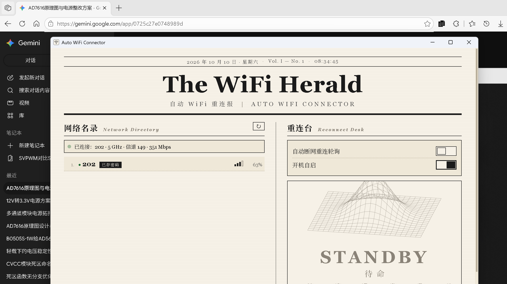

# 任务汇报 — 2026-10-10（v0.3.0）

## 任务 1：Windows Defender 授权框（用户标注为较大问题）

### 分析

开机自启时 explorer 启动带 MOTW（网络来源标记）的 exe，Windows 会显示「无法验证发布者」的授权框。exe 从网络下载即被附加该标记（Zone.Identifier 流）。

### 修复

程序启动时删除自身 exe 的 MOTW 标记（[lib.rs remove_mark_of_the_web](../src-tauri/src/lib.rs)）。首次手动运行后即生效，此后开机自启不再出现授权框。

### 实测

对 debug exe 附加 26 字节 Zone.Identifier 流 → 启动程序 → 标记变为 0 字节（已删除）。实测通过。

## 任务 2：开机自启是新程序还是老程序

### 发现的真实问题

检查本机状态证实用户的疑虑：开机自启注册表指向 `dist\auto-wifi-connector.exe`，该文件是 **v0.1.0**（带黑窗缺陷的撤回版本）。原因：v0.2.4 的「首次运行才注册」逻辑使新版本不再更新自启路径。

附带证据：今天 08:09 的开机自启 RunOnce 验证脚本记录（[autostart-verify.txt](../tests/autostart-verify.txt)）显示开机后启动的正是该老程序（截图处于锁屏界面）。

### 修复

自启同步逻辑改为：已开启时每次启动都重新注册为当前 exe 路径（版本升级、移动位置后自启启动新程序）；用户在界面关闭过则不覆盖。

### 实测

debug exe 启动后，注册表从 `dist\...`（老程序）刷新为当前 exe 路径 ✓。现已注册为 v0.3.0 release 路径。dist 中的 v0.1.0 已删除。

## 任务 3：网络名录功能丰富

### 刷新不闪烁

原因：原实现每 6 秒整体重建列表并播放进入动画。
修复：以 SSID 为键复用行元素，仅更新变化字段；进入动画只对新出现的行播放。
验证：preview 模拟 3 秒周期推送（信号波动），复用行的动画类保持为 0，无闪烁。

### 新增功能

- 行内「连接」按钮：已存密码且未连接的网络可直接点击切换（后端 connect_wifi 命令，name 参数已引号化）
- 标题行刷新按钮：手动重新扫描
- 状态条连接详情：`已连接：202 · 5 GHz · 信道 149 · 351 Mbps`（频段、信道、速率，双语标签解析）

## 发布

- [v0.3.0 下载](https://github.com/MisakaMikoto128/auto_wifi_connector/releases/download/v0.3.0/auto-wifi-connector-v0.3.0-windows-x64.zip)（附 sha256 校验文件）
- 单元测试 23 项通过，CI 与 Release 流水线均绿
- 本机开机自启已注册为 v0.3.0 release 路径
